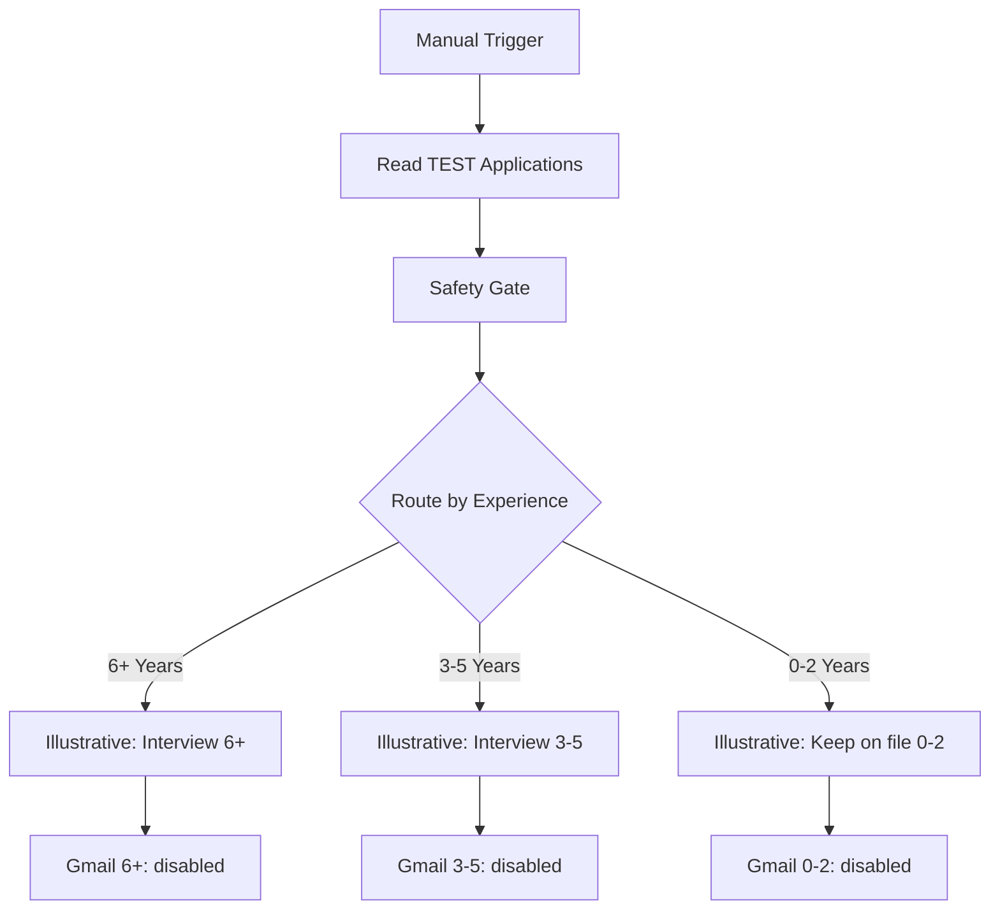

# Recruitment workflow node guide

This guide explains every node in the two sanitized workflows published in this repository: **6 nodes** in the manual routing demo and **10 nodes** in the Google Sheets integration. Node names below match the exported JSON files.

Both workflows are saved **inactive** and start only from a **Manual Trigger**. The manual demo has no external-service nodes. The integrated demo has a Google Sheets read and three Gmail nodes saved with `disabled: true`; its sheet ID and recipients are placeholders, and neither export contains saved credentials.

The experience bands illustrate routing logic, not hiring suitability. The original archived applicant-triggered workflow is a separate artifact: its acknowledgment and HR-notification nodes are not included in these public exports or this guide.

## 1. Manual routing demo — 6 nodes

**File:** [recruitment-routing-manual-demo.json](workflows/recruitment-routing-manual-demo.json)  
**Workflow name:** `PUBLIC DEMO — Recruitment: Routing Only (No External Services)`

The path is Manual Trigger → Test Applicant → Route by Experience → one of three final Edit Fields nodes. It uses a fictional record created inside n8n, so it needs no spreadsheet, account connection or email service.

| Node | n8n type | What it does | Output / next step |
| --- | --- | --- | --- |
| `Manual Trigger` | Manual Trigger | Starts a run when the tester clicks **Execute workflow**. It does not watch a form, sheet or schedule. | Starts `Test Applicant (Edit Fields)`. |
| `Test Applicant (Edit Fields)` | Edit Fields / Set | Creates the fictional input with `Full Name`, `Email Address`, `Position applying for` and `Years of experience`. The saved values are Demo Candidate, `demo-candidate@example.com`, Office Assistant and `3-5 Years`. | Sends that record to `Route by Experience`. Change only the experience value to exercise another category. |
| `Route by Experience` | Switch | Compares `Years of experience` against three exact, case-sensitive strings: `6+ Years`, `3-5 Years` and `0-2 Years`. | Routes the record to the corresponding final node below. No fallback output is configured. |
| `Illustrative: Interview 6+` | Edit Fields / Set | Preserves the input fields and adds `demo_routing_result = Interview invitation — demo only` plus a notice that no email is sent. | Final output for `6+ Years`; no downstream service. |
| `Illustrative: Interview 3-5` | Edit Fields / Set | Preserves the input fields and adds `demo_routing_result = Interview invitation — demo only` plus the same no-email notice. | Final output for `3-5 Years`; no downstream service. |
| `Illustrative: Keep on file 0-2` | Edit Fields / Set | Preserves the input fields and adds `demo_routing_result = Keep on file — demo only` plus the same no-email notice. | Final output for `0-2 Years`; no downstream service. |

The final nodes add demonstration labels; they do not create an interview, store a candidate in another system, send a message or make an actual recruitment decision. For each category test, inspect which final node received the item.

## 2. Google Sheets integration — 10 nodes

**File:** [recruitment-sheets-gmail-safe-demo.json](workflows/recruitment-sheets-gmail-safe-demo.json)  
**Workflow name:** `PUBLIC DEMO — Recruitment: Sheets to Gmail (Manual, Disabled)`

The diagram shows the saved connections. Gmail stages are disabled, so the connected path does not indicate that a message is sent.

| Node | n8n type | What it does | Output / next step |
| --- | --- | --- | --- |
| `Manual Trigger` | Manual Trigger | Starts an explicit manual execution. It is not a Google Sheets row-added trigger. | Starts the Sheets read. |
| `Read TEST Applications (Google Sheets)` | Google Sheets | Uses the **read** operation on worksheet `Form Responses 1`. The export contains `REPLACE_WITH_TEST_SHEET_ID` and no credential. A local test copy needs its own test-sheet configuration. | Supplies sheet rows to the safety gate. It does not append, update or delete rows. |
| `Safety Gate - Demo Candidates Only` | Code, JavaScript | Runs once for all input items. Accepts only the three fictional records in the allowlist below, checks all four routing fields, removes duplicate accepted candidates within the run, and returns at most three items. | Emits rebuilt fictional records to `Route by Experience`. Nonmatching records are omitted. |
| `Route by Experience` | Switch | Applies the same three exact, case-sensitive experience comparisons as the manual demo. | Sends each accepted record to its matching Edit Fields node. No fallback output is configured. |
| `Illustrative: Interview 6+` | Edit Fields / Set | Preserves the accepted record and adds `demo_routing_result = Interview invitation — demo only`. Replaces `test_notice` with the synthetic-applicant / disabled-Gmail notice. | Passes the `6+ Years` record toward `EMAIL TEST - 6+ Years (disabled)`. |
| `Illustrative: Interview 3-5` | Edit Fields / Set | Preserves the accepted record and adds `demo_routing_result = Interview invitation — demo only`, with the same Gmail notice. | Passes the `3-5 Years` record toward `EMAIL TEST - 3-5 Years (disabled)`. |
| `Illustrative: Keep on file 0-2` | Edit Fields / Set | Preserves the accepted record and adds `demo_routing_result = Keep on file — demo only`, with the same Gmail notice. | Passes the `0-2 Years` record toward `EMAIL TEST - 0-2 Years (disabled)`. |
| `EMAIL TEST - 6+ Years (disabled)` | Gmail | Contains a **send-message configuration**, but is saved disabled. Its plain-text template identifies the fictional candidate, position and experience and describes the interview demonstration route. | No Gmail send while disabled. Fixed To placeholder: `YOUR_TEST_INBOX@example.com`. |
| `EMAIL TEST - 3-5 Years (disabled)` | Gmail | Contains the disabled send-message configuration for the `3-5 Years` interview demonstration. | No Gmail send while disabled. Uses the same fixed To placeholder. |
| `EMAIL TEST - 0-2 Years (disabled)` | Gmail | Contains the disabled send-message configuration for the `0-2 Years` keep-on-file demonstration. | No Gmail send while disabled. Uses the same fixed To placeholder. |

### Input fields and safety-gate rules

The [example CSV](examples/demo-applications.csv) retains eight form-response column names. Only four are used by the gate and routing logic:

| Sheet column | How the published workflow uses it |
| --- | --- |
| `Full Name` | Looks up the fictional candidate and identifies duplicates within the batch. |
| `Email Address` | Checks the candidate's expected example.com address. It is not used as the Gmail To address. |
| `Position applying for` | Checks the candidate's expected role. Also appears in the configured Gmail body. |
| `Years of experience` | Checks the candidate's expected band, then selects the Switch output. |
| `Timestamp`, `Phone Number`, `Link to CV or portfolio`, `Why do you want this role?` | Not used by the gate's checks and not copied into its output. |

The allowlist is hard-coded in the Code node:

| Fictional candidate | Expected email | Expected role | Expected experience |
| --- | --- | --- | --- |
| Demo Candidate A | `candidate-a@example.com` | Office Assistant | `6+ Years` |
| Demo Candidate B | `candidate-b@example.com` | Support Specialist | `3-5 Years` |
| Demo Candidate C | `candidate-c@example.com` | Operations Assistant | `0-2 Years` |

For each incoming row, the gate:

1. Converts the four checked values to strings and trims surrounding whitespace. It also lowercases the email before comparison; names, roles and experience remain case-sensitive.
2. Rejects unknown names and any mismatch in email, role or experience. Missing fields do not match.
3. Keeps only the first **valid** occurrence of each candidate. A rejected row does not reserve that candidate's name.
4. Builds a new item containing only the four approved fields and `test_notice = Fictional data only - not a real recruitment decision`. n8n item-pairing metadata links it to the source row.
5. Stops after three accepted records. If none match, it returns no items for downstream routing.

This gate operates **after** the Sheets read. It does not prevent n8n from reading a sheet's input rows, so use only a dedicated sheet containing fictional records. Its `seen` set exists within one Code-node execution; it does not remember candidates across separate runs or prevent repeated sends if someone later enables Gmail.

### Gmail behavior and expressions

All three Gmail nodes are saved with `disabled: true` and no credentials. Each configured subject starts with `[TEST ONLY]`, names its experience branch, and inserts `Full Name`. The body inserts `Full Name`, `Position applying for` and `Years of experience`.

The To field is a fixed placeholder rather than an expression that reads `Email Address`. The Edit Fields notice describes an owner-inbox test, but that text does not validate a future recipient configuration.

n8n passes items through disabled nodes. Green connections or output counts after these nodes therefore demonstrate item flow, **not email delivery**. Keep every Gmail node disabled for the documented routing checks.

## 3. What has been verified

The existing [test record](TESTING.md) documents the sanitized re-execution on **5 November 2026**:

| Check | Recorded result |
| --- | --- |
| Six-node manual demo | All three experience categories passed in separate manual runs. |
| Ten-node integrated demo | Three fictional Sheets rows passed the gate, with one item per branch; saved execution status was **Succeeded**. All Gmail nodes stayed disabled. |
| Mixed edge-case batch | Seven pinned fictional inputs produced only the three valid A/B/C outputs. This separate copy bypassed the Sheets read and kept Gmail disabled. |
| Scope limits | No email delivery, automatic form/row-added trigger, original archived acknowledgment/HR steps, or production recruitment processing was verified in that re-execution. |

This guide documents the published configuration and existing evidence; adding it does not represent a new workflow execution. See [TESTING.md](TESTING.md) for redacted screenshots and the distinction between verified runs and earlier owner-reported delivery.

## Related documentation

- [README.md](README.md) — project overview and verification summary.
- [SETUP.md](SETUP.md) — importing and configuring separate local test copies.
- [TESTING.md](TESTING.md) — recorded results, evidence and untested behavior.
- [SECURITY.md](SECURITY.md) — sanitization and publication scope.
