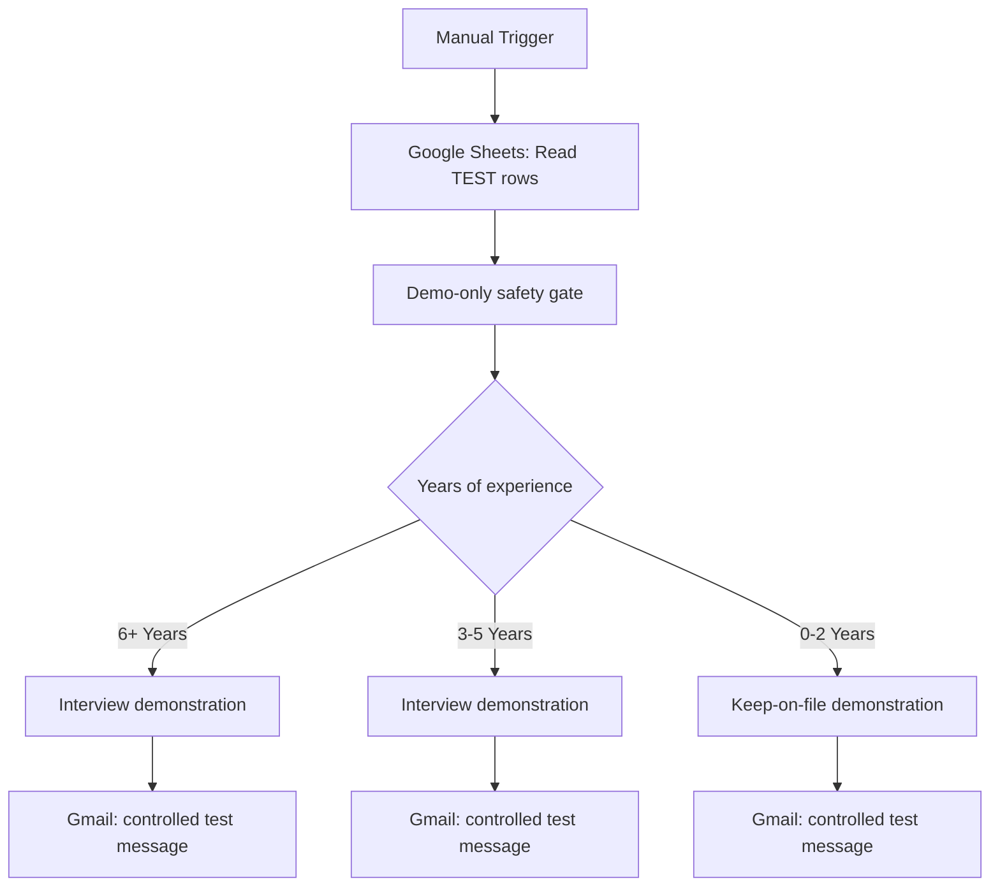

# Recruitment Application Automation — n8n + Google Sheets + Gmail

**Locally tested portfolio prototype · Fictional applicants · Not a production recruitment system**

A recruitment workflow prototype built with n8n Community Edition on Windows with Docker Desktop. The demo reads fictional application rows from Google Sheets, checks a predefined experience category, and illustrates follow-up messages through Gmail. The project demonstrates workflow branching, Google OAuth integration, service orchestration, and safe manual testing.

**Verified sanitized re-execution — 5 November 2026:** Both published JSON workflows were imported into separate, inactive local test workflows and executed manually. The routing-only workflow passed all three experience categories. The integrated workflow read three fictional rows from the dedicated test Google Sheet, passed all three through the safety gate, and routed one item to each matching branch. Its saved execution status was **Succeeded**. **Every Gmail node remained disabled throughout; no email was sent.** See [TESTING.md](TESTING.md) for evidence and scope.

*Redacted evidence from the sanitized re-execution. Green connections through deactivated Gmail nodes represent pass-through, not email delivery.*

Earlier on the same date, the owner reported receiving three branch-specific demonstration emails in their own inbox. That historical delivery report was not independently verified and is separate from this no-email re-execution.

## Workflow overview

The Gmail nodes are **disabled by default** in the published example. The workflow is **inactive** and uses a placeholder for the Google Sheet and receiving email. Importing it does not connect an account or enable sending.

## Node-by-node documentation

See [NODE_GUIDE.md](NODE_GUIDE.md) for every node in both published workflows: the **6-node manual routing demo** and the **10-node Sheets integration**. It explains inputs, exact routing rules, the fictional-record safety gate, output fields, disabled Gmail behavior and the limits of the recorded tests.

## Verified sanitized re-execution results

| Check | Observed outcome |
| --- | --- |
| Routing-only: `6+ Years` | Passed: one item to Interview 6+ only |
| Routing-only: `3-5 Years` | Passed: one item to Interview 3-5 only |
| Routing-only: `0-2 Years` | Passed: one item to Keep on file 0-2 only |
| Integrated Google Sheets read and safety gate | Passed: 3 fictional rows read; 3 items passed |
| Integrated experience routing | Passed: 1 item per matching branch |
| Gmail | All 3 nodes disabled throughout; delivery not tested |
| Final state | Separate test workflows left inactive / unpublished |

An additional **pinned-input safety-gate test** passed on 5 November 2026: seven fictional inputs (including an unknown applicant, mismatched email, invalid experience and duplicate) produced only the three valid A/B/C outputs. This separate inactive copy bypassed Sheets and kept Gmail disabled. See the [edge-case test record](TESTING.md#safety-gate-edge-case-batch--5-november-2026).

## What's inside

- [`workflows/recruitment-routing-manual-demo.json`](workflows/recruitment-routing-manual-demo.json) — **6-node offline-first demo**: no Gmail, no Google Sheets and no external side effects. Best first import.
- [`workflows/recruitment-sheets-gmail-safe-demo.json`](workflows/recruitment-sheets-gmail-safe-demo.json) — **10-node integrated demo**: manual trigger, read-only Sheets input, fictional-only gate, three output branches and three **disabled** Gmail nodes. Contains placeholders only.
- [`examples/demo-applications.csv`](examples/demo-applications.csv) — three synthetic candidates using the original form-response column names.
- [`assets/sanitized-retest-integration.png`](assets/sanitized-retest-integration.png) — redacted sanitized re-execution evidence; additional branch and saved-status screenshots are linked in [TESTING.md](TESTING.md).
- [`assets/recruitment-integration-test.png`](assets/recruitment-integration-test.png) — earlier owner-supplied local test screenshot.
- [`SETUP.md`](SETUP.md), [`TESTING.md`](TESTING.md), [`SECURITY.md`](SECURITY.md), [`PORTFOLIO.md`](PORTFOLIO.md) — setup, verification, security and portfolio notes.

## Quick start

1. Run n8n Community Edition locally or in another workspace you control.
2. Import the **routing-only JSON** and use **Execute workflow**. Change `Years of experience` in the test-applicant node to explore all three branches.
3. For the integrated example, follow [SETUP.md](SETUP.md): use a **dedicated test sheet** containing only the fictional rows; replace `REPLACE_WITH_TEST_SHEET_ID`; configure Google Sheets OAuth locally; check the `Form Responses 1` tab. **Leave every Gmail node disabled** for the routing test.
4. After testing, disable all Gmail nodes and keep the workflow **inactive**. **Never** point this example at an applicant database or production form.

## Limitations and responsible use

Both sanitized public workflows were **separately re-executed after sanitization** on 5 November 2026. Only the local test copies were configured: experience input was varied for the routing-only test, and the integrated copy used an existing local Sheets credential and the dedicated test sheet. Public JSON files retain placeholders, no saved credentials, and disabled Gmail nodes. These are manual routing/integration checks; email delivery was not tested in this re-execution. The original archived six-node applicant-triggered workflow and its acknowledgment/HR-notification steps have **not** been tested end to end during this demonstration.

The experience brackets illustrate **conditional logic only**, **not hiring suitability**. Actual recruitment workflows need human review, fair hiring criteria, privacy protections, error handling, consent/notice where required, deduplication and security testing. Do not use this automation for actual candidate decisions.

**Security:** This repository intentionally excludes credentials, account identities, Google Sheet IDs, actual candidate records and legacy Git history. See [SECURITY.md](SECURITY.md).
