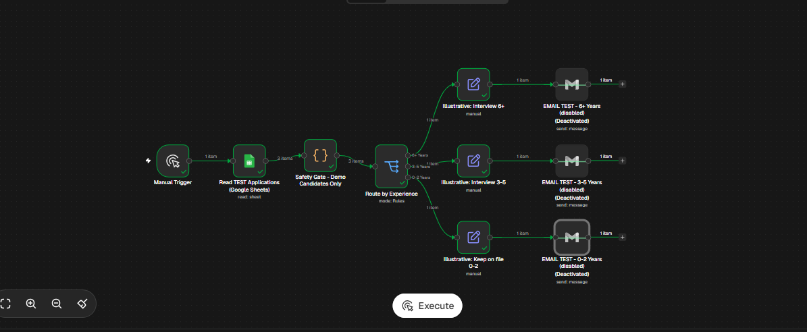
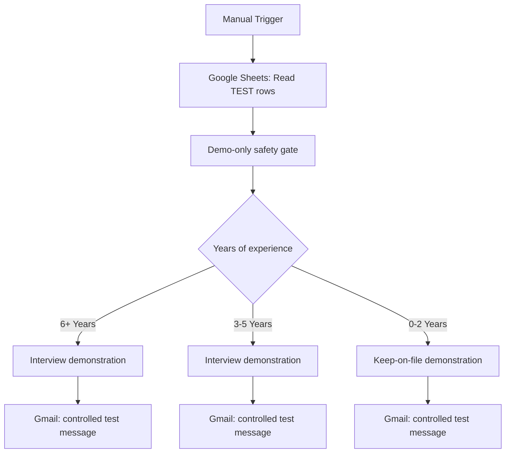

# Recruitment Application Automation — n8n + Google Sheets + Gmail

**Locally tested portfolio prototype · Fictional applicants · Not a production recruitment system**

A recruitment workflow prototype built with n8n Community Edition on Windows with Docker Desktop. The demo reads fictional application rows from Google Sheets, checks a predefined experience category, and illustrates follow-up messages through Gmail. The project demonstrates workflow branching, Google OAuth integration, service orchestration, and safe manual testing.

**Testing transparency:** On **5 November 2026**, the project owner reported successful manual routing for all three categories, successful reading of three synthetic Google Sheets records, and receipt of three branch-specific Gmail messages sent **only to their own inbox**, one branch at a time. The actual editor screenshot below shows the routing execution, including three items processed and all three Gmail nodes **disabled after testing**. The delivered emails were not independently verified by viewing inbox contents. See [TESTING.md](TESTING.md).

*Actual local test-workflow screenshot; synthetic inputs only. The screenshot demonstrates routing and disabled email nodes, not independent email-delivery evidence.*

## Workflow overview

The Gmail nodes are **disabled by default** in the published example. The workflow is **inactive** and uses a placeholder for the Google Sheet and receiving email. Importing it does not connect an account or enable sending.

## Recorded demonstration results

| Experience input | Expected routing outcome | Reported outcome |
| --- | --- | --- |
| `6+ Years` | Interview demo | Passed |
| `3-5 Years` | Interview demo | Passed |
| `0-2 Years` | Keep-on-file demo | Passed |
| Three synthetic Google Sheet rows | One item per branch | Passed |
| Gmail messages to owner's inbox | Three individually tested messages | Owner reported receipt |
| Gmail nodes disabled after test | No further Gmail execution | Confirmed by owner and visible in screenshot |

## What's inside

- [`workflows/recruitment-routing-manual-demo.json`](workflows/recruitment-routing-manual-demo.json) — **6-node offline-first demo**: no Gmail, no Google Sheets and no external side effects. Best first import.
- [`workflows/recruitment-sheets-gmail-safe-demo.json`](workflows/recruitment-sheets-gmail-safe-demo.json) — **10-node integrated demo**: manual trigger, read-only Sheets input, fictional-only gate, three output branches and three **disabled** Gmail nodes. Contains placeholders only.
- [`examples/demo-applications.csv`](examples/demo-applications.csv) — three synthetic candidates using the original form-response column names.
- [`assets/recruitment-integration-test.png`](assets/recruitment-integration-test.png) — actual local n8n execution screenshot.
- [`SETUP.md`](SETUP.md), [`TESTING.md`](TESTING.md), [`SECURITY.md`](SECURITY.md), [`PORTFOLIO.md`](PORTFOLIO.md) — setup, verification, security and portfolio notes.

## Quick start

1. Run n8n Community Edition locally or in another workspace you control.
2. Import the **routing-only JSON** and use **Execute workflow**. Change `Years of experience` in the test-applicant node to explore all three branches.
3. For the integrated example, follow [SETUP.md](SETUP.md): create a **separate test sheet**; use fictional rows; replace `REPLACE_WITH_TEST_SHEET_ID`; configure Google Sheets OAuth separately; set Gmail recipients to **an inbox you control**; enable just one Gmail node at a time if testing delivery.
4. After testing, disable all Gmail nodes and keep the workflow **inactive**. **Never** point this example at an applicant database or production form.

## Limitations and responsible use

This public example is a **newly sanitized copy**, not the original 2026 test export; its placeholders must be configured before use and it has **not been separately re-executed after sanitization**. The original archived six-node applicant-triggered workflow and its acknowledgment/HR-notification steps have **not** been tested end to end during this demonstration.

The experience brackets illustrate **conditional logic only**, **not hiring suitability**. Actual recruitment workflows need human review, fair hiring criteria, privacy protections, error handling, consent/notice where required, deduplication and security testing. Do not use this automation for actual candidate decisions.

**Security:** This repository intentionally excludes credentials, account identities, Google Sheet IDs, actual candidate records and legacy Git history. See [SECURITY.md](SECURITY.md).
