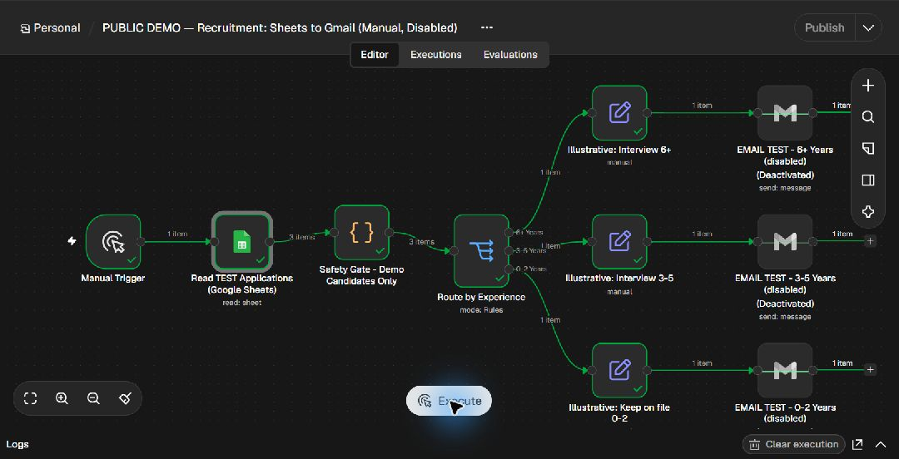
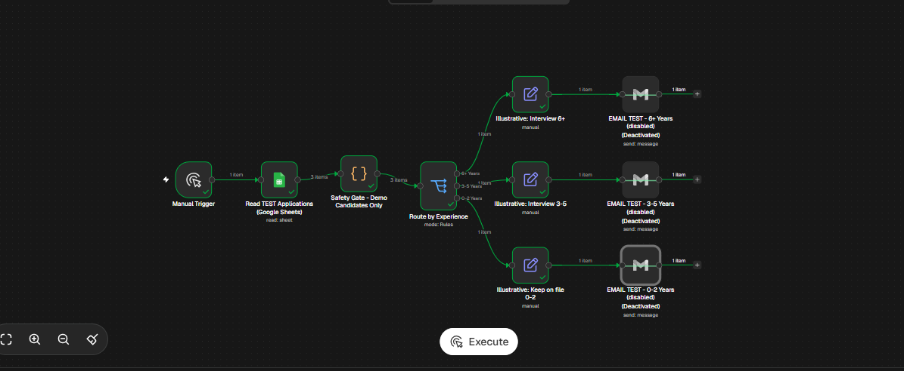

# Test record and evidence

**Test date:** 5 November 2026  
**Environment:** Windows laptop, Docker Desktop, self-hosted n8n Community Edition  
**Data:** Fictional test records only  
**Source:** Direct observation of sanitized workflow re-executions in local n8n, plus separately identified earlier owner reports.

## Verified re-execution of the sanitized exports

Both JSON files from [source revision `1b7bd87`](https://github.com/jasperosas/recruitment-automation-n8n-portfolio/tree/1b7bd870e963c263fc9b148a9c3c1ee56d71b0aa) were imported into **separate new local test workflows**, kept **inactive / unpublished**, and executed manually on 5 November 2026. Production recruitment records and workflows were not used. No applicants were contacted. Every Gmail node remained disabled throughout.

The routing-only workflow used its fictional `Demo Candidate` and `demo-candidate@example.com` fixture. Only `Years of experience` was changed between the three runs. The integrated copy used the existing local Google Sheets credential and the dedicated **Recruitment Automation — TEST ONLY** sheet, tab `Form Responses 1`. Changing the document ID cleared the tab setting in the editor; `Form Responses 1` was explicitly restored before execution. The sheet contained Demo Candidate A/B/C with example.com addresses. The sanitized logic and all Gmail settings were retained.

| Workflow / check | Directly observed result | Redacted evidence |
| --- | --- | --- |
| Routing-only: `3-5 Years` | Success; one item to Interview 3-5, other branches idle | [3-5 branch](assets/sanitized-retest-routing-3-5.png) |
| Routing-only: `6+ Years` | Success; one item to Interview 6+, other branches idle | [6+ branch](assets/sanitized-retest-routing-6-plus.png) |
| Routing-only: `0-2 Years` | Success; one item to Keep on file 0-2, other branches idle | [0-2 branch](assets/sanitized-retest-routing-0-2.png) |
| Integrated: Sheets and safety gate | Three fictional rows read; three safe items passed | [Integrated routing](assets/sanitized-retest-integration.png) |
| Integrated: all categories | One item per matching branch: A → 6+, B → 3-5, C → 0-2 | [Integrated routing](assets/sanitized-retest-integration.png) |
| Integrated: saved execution | **Succeeded**, duration **40.353 seconds** in execution history | [Saved status](assets/sanitized-retest-succeeded.png) |
| Gmail / final state | All three Gmail nodes deactivated; both test copies left unpublished | [Disabled Gmail nodes](assets/sanitized-retest-integration.png) |

**Reading the evidence:** n8n passes items through disabled nodes. Green connections and item counts beyond the deactivated Gmail nodes do **not** show that Gmail sent messages. This re-execution did not test email delivery. Screenshots were cropped to exclude browser tabs, account controls and address bars; the saved-status screenshot also masks local execution metadata. No sheet IDs, credential identifiers or real applicant records are included.

The public JSON files were not replaced with configured local exports. They retain the placeholder sheet ID and recipients, no saved credentials, inactive state and disabled Gmail nodes.

## Earlier owner-reported demonstration

The following records describe the owner's earlier tests, not the sanitized re-execution above.

| Check | Scope | Evidence / outcome |
| --- | --- | --- |
| Manual routing | Six-node manual workflow without external integrations | Owner reported correct paths for `6+ Years`, `3-5 Years`, `0-2 Years` |
| Google Sheets integration | Dedicated fictional-data sheet; read-only node | Owner reported successful execution, three rows; screenshot shows 3 items leaving Sheets read node |
| Gmail standalone | One manually initiated email to owner's inbox | Owner reported receipt |
| Integrated Gmail: 6+ | Manually enabled one Gmail branch | Owner reported receipt |
| Integrated Gmail: 3-5 | Manually enabled one Gmail branch | Owner reported receipt |
| Integrated Gmail: 0-2 | Manually enabled one Gmail branch | Owner reported receipt |
| Post-test | Three Gmail nodes disabled; no active trigger | Screenshot shows all 3 Gmail nodes deactivated; owner confirmed disabled |

## Screenshot of actual local execution

The screenshot visibly includes a manual trigger, a Google Sheets read, a fictional-record safety gate, three experience outputs, and deactivated Gmail nodes. There is **one item per experience branch**. It supports **execution and routing** observations, **not independent receipt of delivered emails**.

## Architecture: original archive vs. safe test

The original archived n8n workflow had a Google Sheets `rowAdded` trigger, applicant acknowledgment, HR notification and routing to invitation or keep-on-file messaging. That **original archival workflow was not re-tested end to end**. The local successful tests were conducted in **separate manual demo workflows**, intentionally avoiding live forms and real recipients.

## Not tested or not verified

- Automatic triggering after a real Google Form submission or on live Sheets row addition.
- Applicant acknowledgment and HR notification nodes from the original archived workflow.
- Emailing real candidates or processing real applications.
- OAuth-expiry recovery, duplicate-row/duplicate-send behavior, rate limits, outages, simultaneous executions or malicious input.
- Hiring outcome suitability, bias/fairness, legal compliance, or production readiness.

**Note:** This demonstration uses experience bands solely to show routing logic. Actual hiring processes require human review and appropriate hiring/privacy policies.
